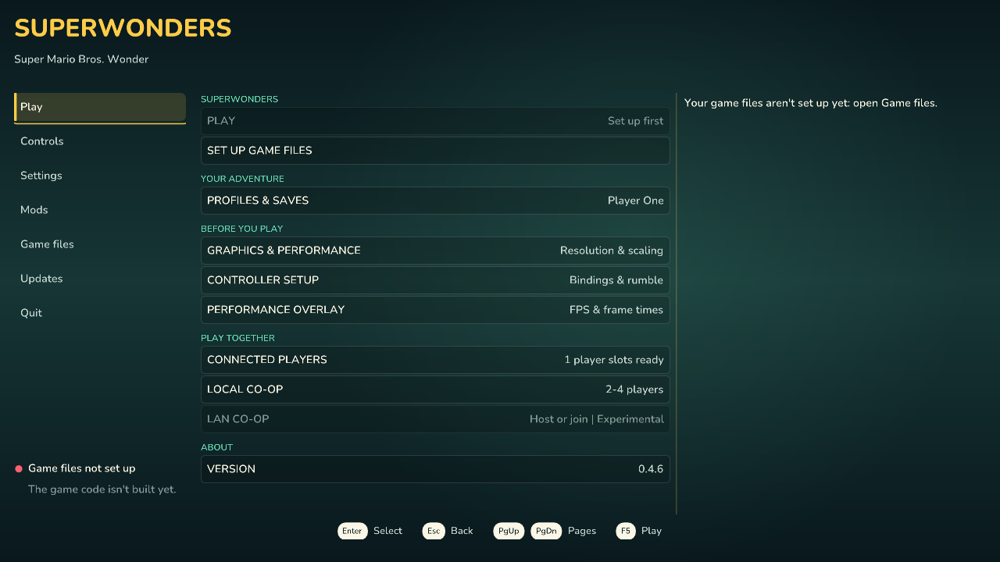

<h1 align="center">SuperWonders</h1>

<b>Super Mario Bros. Wonder, recompiled for PC.</b> One project for original Switch Wonder and Nintendo Switch 2 Edition. Native PC runtime powered by Vulkan, with one shared edition launcher.

  <a href="docs/PLAYING-WONDER.md">Start playing</a> ·
  <a href="docs/MULTIPLAYER.md">Multiplayer</a> ·
  <a href="docs/WONDER-EDITIONS.md">Game editions</a> ·
  <a href="docs/FORK-ROADMAP.md">Roadmap</a> ·
  <a href="CONTRIBUTING.md">Contributing</a> ·
  <a href="https://github.com/VictorMerk/SuperWonders/issues">Report a bug</a>

SuperWonders translates Wonder's AArch64 executable ahead of time and runs it through a native PC runtime. Its NVN graphics implementation uses Vulkan. This fork builds on [vfjoo888/SuperWonders](https://github.com/vfjoo888/SuperWonders), with additional work on graphics correctness, controllers, launchers, diagnostics and multiplayer experiments.

**Bring your own game files.** This repository contains source and documentation, not Nintendo game data, firmware, keys or a compiled game. Generated game libraries and assets stay on your machine.

## Two Wonder editions, one launcher

**This fork targets both the original Nintendo Switch version of Wonder and the Nintendo Switch 2 Edition.** Original Wonder remains part of the project while work continues on the supplied upgraded-edition package.

| Edition | Preparation and launch |
| --- | --- |
| **Nintendo Switch - original Wonder** | Prepare the supported original executable and its matching assets. Keep its own compatible runtime, generated game library and data folder. |
| **Nintendo Switch 2 Edition** | The supplied package's inspected **Product.120** executable has a separate port and version-checked integration. Keep its own compatible runtime, generated game library and data folder. Complete edition-specific content and services still need verification. |

`Start Wonder Library.cmd` opens the shared launcher and lets you choose either prepared installation. Shared runtime and UI improvements are developed in this repository; each edition still needs a compatible build and its own regression checks. Reuse prepared game code when its ABI remains compatible. An older original-edition library cannot simply be substituted for the upgraded edition, or paired with a newer incompatible runtime.

See [preparing and selecting editions](docs/PLAYING-WONDER.md#choose-an-edition) and the [edition support evidence](docs/WONDER-EDITIONS.md). Neither the package label nor a successful base-game run certifies all Switch 2 Edition features such as Bellabel Park or GameShare.

*The PC launcher in an isolated test installation, with no game data configured. The LAN entry is experimental; this screenshot does not demonstrate working multiplayer.*

## Play on PC

1. Read the [playing guide](docs/PLAYING-WONDER.md) and check your hardware and game version.
2. Prepare the game using your own extracted ExeFS and RomFS. The [upstream Windows GUI Builder](https://github.com/vfjoo888/SuperWonders/releases) is a separate distribution; its releases may not include this fork's latest changes.
3. Start the prepared `wonder.exe`, configure your controls and play. First-launch shader preparation can take time.

Already have a prepared installation? Keep its data, saves and generated game library when updating. Runtime/library compatibility matters; see [updating safely](docs/PLAYING-WONDER.md#updating-an-existing-installation).

## What is here

- **Graphics and display:** internal resolution, FSR 1, FXAA, anisotropic filtering, shader/pipeline caches and optional frame generation.
- **Controls:** keyboard, Xbox/DualSense and Nintendo layouts, remapping, rumble and four local controller slots.
- **PC launcher:** settings, save backups, RomFS mod inspection and conflict reporting.
- **Diagnostics:** FPS and frametime overlays, bounded graphics/network traces and reproducible test tools.
- **Edition library:** one launcher with separate prepared runtime/data slots for original Nintendo Switch Wonder and the Nintendo Switch 2 Edition installation.

Frame generation adds displayed frames; it does not establish faster simulation or lower input latency. Driver behavior, shader compilation and the chosen settings still affect performance.

## Current status

| Area | Established coverage | Remaining work |
| --- | --- | --- |
| Original Wonder 1.0.0 | Upstream Windows/Linux support; this fork's separate original-edition launcher slot reaches the title screen. | A full original-edition regression on the latest runtime. |
| Inspected Product.120 update | Version-specific runtime support; gameplay, course transitions, saved progress and non-silent audio exercised in bounded Windows runs. | All courses, the historical intermittent crash sequence and complete visual correctness. |
| Switch 2 Edition features | A supplied package was inspected and its updated executable ported. | Complete upgraded content, Bellabel Park and GameShare are **not certified**. Package names or graphics SDK markers alone do not settle this. |
| Graphics | Several shader, texture and resource-lifetime fixes have targeted regressions. | Pause-menu blur after reopening and intermittent stage-map shadows need further visual checks. |
| Multiplayer | Local controller support; separate launch paths for one-host co-op and networking experiments. | Shared-input LAN has **known gameplay desync**. The new native networking backend has not passed a real room/gameplay test. |

Read the [edition investigation](docs/WONDER-EDITIONS.md) and [multiplayer guide](docs/MULTIPLAYER.md) for each result's scope. Passing CPU tests, matching input packets or a clean process exit do not certify gameplay.

## Hardware and performance

The current desktop target is an **x86-64 CPU with AVX2** and a **Vulkan 1.3 GPU/driver**. A practical starting point is **16 GB RAM**; building with more workers can benefit from 32 GB. A verified minimum VRAM requirement has not been established.

Upstream reports testing on NVIDIA RTX 5060 Ti and contributor AMD RX 9070 XT systems on Windows/Linux. Intel graphics support remains early. These are compatibility observations, not promises for other hardware. This fork does not currently publish a controlled benchmark proving an FPS improvement from its latest changes.

For useful bug reports, include the exact runtime revision, game version, CPU/GPU/driver, internal resolution, frame-generation setting and steps to reproduce. Remove private paths, pairing codes and credentials from shared diagnostics. [Contribution guidance](CONTRIBUTING.md) covers code and reports.

## Explore the project

| Looking for… | Read… |
| --- | --- |
| Setup, settings, controllers and mods | [Playing Wonder](docs/PLAYING-WONDER.md) |
| Local co-op, desync and native networking | [Multiplayer](docs/MULTIPLAYER.md) |
| Steam/Spacewar developer prototype | [Steam development](docs/WONDER-STEAM-DEV.md) |
| Networking evidence and next experiments | [Synchronization investigation](docs/WONDER-SYNC-INVESTIGATION.md) |
| Versioned executable/package support | [Wonder editions](docs/WONDER-EDITIONS.md) |
| Remaining work and graphics follow-up | [Fork roadmap](docs/FORK-ROADMAP.md) |
| Earlier preview changes and their limits | [PC preview](docs/PC-PREVIEW-2026-11-17.md) |

`recomp/` holds executable analysis and code generation; `runtime/` implements platform services, audio, input and Vulkan graphics; `games/wonder/` holds game integration; `tools/` contains preparation and development utilities.

## Credits and licensing

This fork continues [vfjoo888's SuperWonders](https://github.com/vfjoo888/SuperWonders), originally adapted from the DKB/TOTK recompilation framework. Thanks to [devall96](https://github.com/devall96) for work shared in upstream pull requests #20–#33: selected ideas and implementations informed asynchronous pipeline preparation/cache saving, Vulkan validation fixes, Linux support, graphics pipeline libraries, graphics/frame-rate options, release tooling and performance/replay diagnostics. Those pull requests were not merged as a batch; PR #25's feedback-loop copy change was not included in that integration.

[mkw-recomp](https://github.com/adriadam10/mkw-recomp) is a valuable technical reference and inspired this documentation's organization. Individual reused third-party material retains its notices. AI tools have been used extensively in development and documentation; testing limits remain part of the project's status.

Project source is [MIT licensed](LICENSE). See [third-party notices](THIRD_PARTY_NOTICES.md) for components and artwork. That license grants no rights to Nintendo's game or trademarks. *Super Mario Bros. Wonder* and *Nintendo Switch* are Nintendo trademarks. This is an unofficial fan project, unaffiliated with Nintendo.
