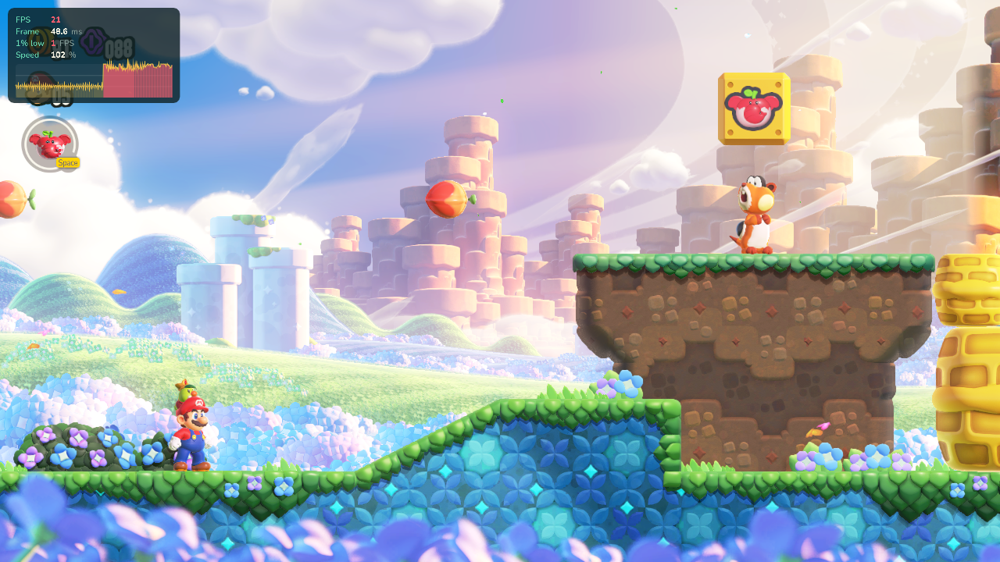
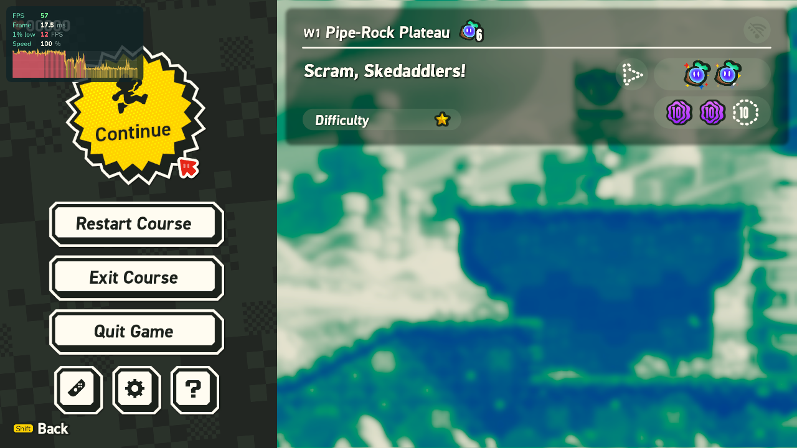

# AMD graphics corrections — 18 November 2026

The r8-compatible graphics branch is based on `105c586`. Its game logic, LAN code and timing code are unchanged. The separate integration branch applies the same graphics changes to `e48f1a6`; it is not the binary installed for this task.

## Changes

- **Complete draws after a legacy-settings upgrade.** Old `pipeline_skip_draws=1` files migrate to preserving every draw. Such settings otherwise hide objects until a first-use pipeline finishes compiling, which can be particularly visible on AMD. A versioned, explicit new opt-in still survives restart. Startup preparation and ordinary pipeline caching remain enabled.
- **Fresh depth-comparison copies.** Color textures sampled through shadow samplers use a D32 copy. Its old freshness check tracked render passes only. Uploads, queued texel writes, copies, transfer clears and storage-image bindings now advance a content version too. Retiring the original image releases its copy and views, preventing stale same-size handle reuse and accumulated orphan allocations.
- **Legacy shader NaN behavior.** Runtime normalization replaces GLSL `FMin/FMax/FClamp` with `NMin/NMax/NClamp`, matching the translator's existing Maxwell correction even with older prepared shader packs. Unrelated extended instruction sets are untouched. The preparation marker changes so affected programs are prepared again. The RX 570 numerical test passed both before and after this correction: this is compatibility hardening, not a demonstrated cause of its pause colors.
- **Native unsigned HDR on supported AMD Windows devices.** R11G11B10 render targets use their native unsigned format when all required format features are available. Other Windows GPU vendors retain their previous choice. `NX_R11G11B10_EMULATE=1` retains the widened path for diagnosis.

## Correction: the pause tint

The earlier handoff incorrectly classified the blue/green pause background as a known rendering failure. A capture of the input to fragment shader `8d2597627e69be11` has normal scene colors. The shader deliberately converts luminance through these supplied linear RGB palette values:

| Uniform | RGB | Purpose in the shader |
| --- | --- | --- |
| c3[1] | 0, 12/255, 71/255 | dark endpoint |
| c3[3] | 0, 79/255, 39/255 | middle color |
| c3[2] | 201/255, 195/255, 161/255 | bright endpoint |

The blue, green and cream result follows that explicit palette. Tint alone is not evidence of shader corruption; the game’s filter is preserved. `NX_TRACE_FS_UNIFORMS=<fragment hash>` provides a bounded first-use capture of up to eight rows in four uniform banks for future investigations.

## Verification and limits

Final r8-compatible source: 29 non-GPU CTest cases and three standalone GPU CTest cases passed on the Radeon RX 570 with the Khronos validation layer. The GPU cases cover ASTC, logical 32-lane subgroup behavior, and NaN/finite/infinite min/max/clamp values. A patched real pause shader also passed SPIR-V validation.

The counter/clear probe now has 12 cases. Three new cases cache a comparison copy, update its source through texel writes, a clear or an upload, read back every converted D32 value, and verify copy removal. All 12 passed in synchronous, pipelined and asynchronous modes: 36 readback cases, zero core/synchronization validation errors, with layer loading confirmed.

The final r8-compatible 16:9 game fixture reached the title, world map, Scram, Skedaddlers!, three pause/resume cycles, movement and jumping with 4x optical-flow presentation. Captures were visually inspected; no black blocks or missing geometry were observed in the inspected images. Logs reported zero skipped draws and zero validation errors. Ten existing unused-fragment-output warnings remain.

The first r8 graphics route completed and was deliberately stopped by the owning harness at course frame 2493: r8 does not contain the newer `NX_TEST_QUIT_FRAME` hook. The old harness's exit-code check therefore failed with exit -1; that failed result is preserved and is not labeled a normal exit. A separate controller-scripted settings-menu quit then passed with exit code 0 and zero validation errors.

Development integration runs also covered the longer route without frame generation and with 4x presentation, both exiting through the newer opt-in QA hook with code 0 and zero validation errors. These are separate from the final r8 route.

This covers one RX 570, one driver and this route. It does not certify every course, driver, frame-generation occlusion or long-session artifact, and makes no FPS-improvement claim. It does not validate new generated ultrawide game data or physical LAN behavior.

First launch may spend several minutes preparing corrected shaders. A development run prepared all 11,304 affected programs with zero failures in 206.3 seconds; subsequent runs reuse the marker and driver cache.

References: [Khronos sampling requirements](https://docs.vulkan.org/spec/latest/chapters/textures.html), [Khronos synchronization](https://docs.vulkan.org/spec/latest/chapters/synchronization.html), and the existing translator correction in `tools/maxwell/spirv_harness/translator/spirv-nan.patch`.

## Windows migration follow-up

The subsequent real-session log exposed a Windows-specific omission: the separate Win32 reader/writer bypassed the original shared-parser migration. The upgrade claim above was incomplete for Windows. See [the correction and native platform regression](FPS-SPIKES-2026-11-18.md). The zero-skipped-draw QA routes above used fixtures with skipping already disabled; they did not prove migration from an enabled Windows setting.
