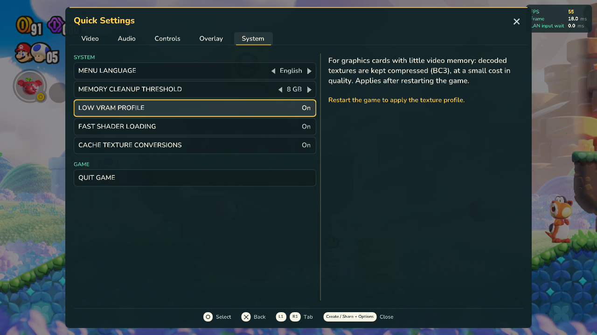

# LAN stalls, buffered transport and scoped random seeds

## Why the r8 test could be much slower than solo

The live r8 two-PC log recorded about 18–22 base FPS. A later steady interval reported 7.25 ms replay, 6.21 ms fence wait, 8.41 ms presentation and a 28.62 ms smoothed LAN input barrier. These are different timing windows and can overlap; summing them is not an exact frame-time accounting. They show that both rendering and LAN synchronization need attention. Intervals with no new pipelines rule out shader compilation as the sole explanation for sustained slow play.

r8 exchanges input synchronously after the complete Wonder framework frame. Network waits therefore sit on the simulation's critical path. One slow peer or a high-latency link can hold everybody back. Unlike solo's real-time frame-step adjustment, LAN deliberately uses the same fixed 1/60-second simulation step on both PCs. At 20 computed frames per second, that can also mean slow game time. Independently adjusting each PC's game time would introduce another desync source.

The earlier same-PC r7 test logs already contained sub-60 FPS intervals, including about 45–52 FPS. They were functional input/partial-position tests, not proof of smooth two-PC play. Their successful assertions must not be presented as a performance gate. Similarly, the old teardown was a normal host menu quit followed by the guest detecting socket disconnect 10054; it was not a normal menu quit on both peers.

## Experimental one-frame overlap

`OneAhead` uses one persistent transport worker and at most one outstanding exchange. The simulation consumes the previous exchange while the next exchange runs. Startup has one additional neutral frame. Inputs remain ordered and authenticated; there is no predicted input or rollback.

The launcher offers **Overlap LAN networking (experimental)**, off by default. At this stage both PCs must select the same mode; the mode participates in the compatibility fingerprint. `NX_LAN_PIPELINE=1` is the unattended-test equivalent. It is a tradeoff: one extra buffered input frame can hide transport waits, but can increase input age on an already fast link. It is not zero input latency. Frame traces retain the original sampling timestamp when buffered inputs are applied, rather than restarting the latency clock after waiting.

The in-game LAN input-wait metric measures time the simulation actually blocks. The CSV recorder's `wait_ns` measures the complete transport exchange on its worker. These quantities differ in overlap mode. A low foreground wait does not mean zero network delay or zero input age.

Detected exchange errors reach the simulation before another transport job is queued. The simulation may already have advanced one buffered frame. There is no full-world verification, repair or live rollback. The partial player guard does not verify Random selection, secondary actors, enemies or all gameplay state.

## Controlled transport measurement

The [raw results](data/lan-pipeline-bench-20261118.json) contain three interleaved 80-exchange runs per mode and two zero-delay controls. The authenticated TCP session and the same `OneAhead` implementation are exercised without a game or GPU workload.

The delay was configured as 5 ms per direction, but Windows timer scheduling made the observed mean forwarding delay about **15.3 ms**, and the requested 8 ms fake frame work actually slept about **15.3 ms**. Report those observed values; this is not a measured 10 ms home-network RTT.

The median host time per tick was **46.791 ms serial** and **31.503 ms overlapped** in this synthetic delayed case, about 32.7% shorter. Every tested input and tick was verified. The zero-delay controls were essentially unchanged (15.469 versus 15.487 ms). These are exchange-throughput results, not Wonder FPS or physical controller-to-display latency measurements. They do not establish the gain on either player's PC.

Removing only the per-frame acknowledgement was also tried privately. One delayed comparison showed no meaningful throughput gain, so that protocol change was not adopted. The existing acknowledgement remains in the transport.

Build `netplay_latency_bench` with the test targets, then run:

```text
python tools/perf/lan_delay_bench.py --binary PATH/TO/netplay_latency_bench.exe --output serial.json
python tools/perf/lan_delay_bench.py --binary PATH/TO/netplay_latency_bench.exe --output overlap.json --pipeline
```

On Windows, `--dll-dir PATH/TO/LLVM-MINGW/bin` can supply the compiler's runtime DLLs. The proxy binds only loopback. Use new output names to retain previous evidence. No firewall settings, game processes or external PCs are modified by this synthetic benchmark.

## Scoped RNG initialization

Static inspection of the user's Wonder 1.0.0 code identified five GetSystemTick call sites immediately feeding MT-style random-state initialization. Returning host time there gives the two native instances different initial states even though the OS entropy SVC already shares the session seed.

The Wonder-specific filter substitutes a seed derived from the shared session seed and the recognized constructor's call-site offset. It verifies eight instruction words at each exact return-address selector and rejects unexpected code. It registers before guest module constructors run, since registering after initialization misses static random generators. Other tick reads, pacing and polling loops retain real time. Solo is unaffected.

There is no host clock, heap address, host thread ID or scheduling-dependent global counter in the substituted seed. Repeated objects created through the same recognized constructor share the initial seed within a session; this can correlate their random streams and still needs broader gameplay review. Other RNG sources and actor state are not assumed covered.

A native two-instance test selected Random for player 2 and captured **Peach on both clients**. This is one matching reproduction, not proof that every Random path or all game state is fixed. The earlier manually selected route and this new Random route reached the course with matching observed primary-player positions.


## Native validation and open failures

The Windows build and 35 non-GPU CTest targets passed after the RNG integration. These include serial and buffered real TCP exchanges with 2/4 participants, queue order/cancellation/errors, original sample timestamps, narrow seed selectors, changed-code rejection and exclusion of framework timer calls. Later shutdown changes passed the ten focused LAN/frame-trace targets.

Before these later transport/RNG changes, the merged runtime passed 27 counter/clear GPU cases, 87 interpolation readbacks, four overlay/controller bridge cases and eight texture cases. The five applicable GPU/UI probe processes confirmed the Vulkan validation layer and reported zero validation errors. Those results do not certify the new gameplay changes or visual correctness.

One native overlap route produced 4,095 matching committed input pairs and 2,083 matching available primary-player positions in the retained trace window. Character IDs are absent from that guard. Its shutdown test failed and required QA cleanup, so the complete run is not a pass. A subsequent Random run captured matching Peach selections but also failed the controller-driven exit automation. Shutdown now has a single owner, stops LAN transport before cache flushing, suppresses cancellation errors during an intentional exit, and routes window-close through the common cleanup. A controlled render-thread shutdown at frame 500 then completed with **exit code 0 on both native instances**, retained process handles and all cleanup checkpoints. This does not certify every menu-navigation or shutdown path. The test hook is `NX_TEST_QUIT_FRAME` and requires overlay frames to be built.

These runtime tests reuse the existing 16:9 recompiled game fixture. They do not validate a newly rebuilt complete setup kit or expanded-camera ultrawide.

A later full Random course run completed the scripted course portion with **4,095 matching committed input pairs and 2,043 matching available primary-player positions** in the retained window. The host menu quit returned code 0; the guest then detected the socket disconnect and returned code 2, as explicitly checked. This is successful disconnect handling, not a normal guest menu quit. [Retained comparison and exit results](data/lan-native-overlap-20261118.json). A separate hover/shutdown run also confirmed Random selection visually and returned code 0 on both render-thread exits at frame 2200. All these paired runs use loopback and share one RX 570; they do not certify physical-network pacing or all actor state.



The PlayStation hint capture uses the Nintendo controller preset, hence Circle confirms and Cross goes back. Icon choice does not silently change bindings; the separate controller preset determines that mapping.

The native pause capture also still shows incorrect blue/green background colors. Zero Vulkan validation errors do not make that image correct. This remains a known rendering failure. Real two-PC performance, all character/actor synchronization, all shader flicker, profiles/nicknames and a new complete matching kit remain unfinished. The installed r8 builds and their immutable ZIPs are unchanged.


