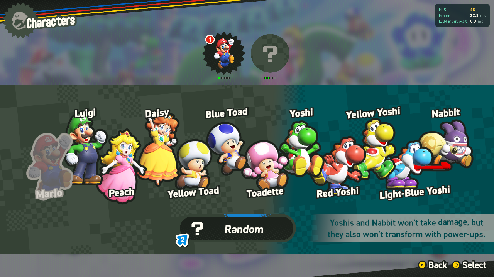
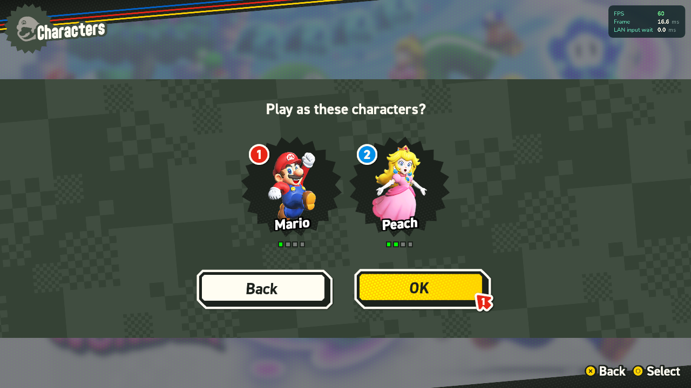
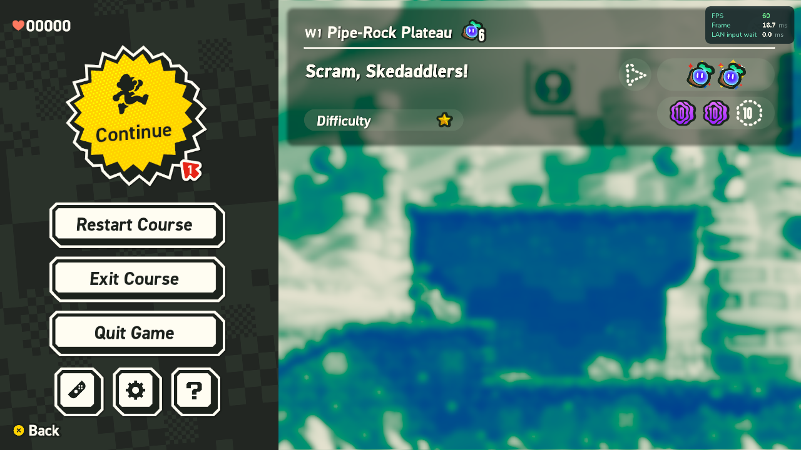

# LAN stalls, buffered transport and scoped random seeds

## Why the r8 test could be much slower than solo

The live r8 two-PC log recorded about 18–22 base FPS. A later steady interval reported 7.25 ms replay, 6.21 ms fence wait, 8.41 ms presentation and a 28.62 ms smoothed LAN input barrier. These are different timing windows and can overlap; summing them is not an exact frame-time accounting. They show that both rendering and LAN synchronization need attention. Intervals with no new pipelines rule out shader compilation as the sole explanation for sustained slow play.

r8 exchanges input synchronously after the complete Wonder framework frame. Network waits therefore sit on the simulation's critical path. One slow peer or a high-latency link can hold everybody back. Unlike solo's real-time frame-step adjustment, LAN deliberately uses the same fixed 1/60-second simulation step on both PCs. At 20 computed frames per second, that can also mean slow game time. Independently adjusting each PC's game time would introduce another desync source.

The earlier same-PC r7 test logs already contained sub-60 FPS intervals, including about 45–52 FPS. They were functional input/partial-position tests, not proof of smooth two-PC play. Their successful assertions must not be presented as a performance gate. Similarly, the old teardown was a normal host menu quit followed by the guest detecting socket disconnect 10054; it was not a normal menu quit on both peers.

## One-frame overlap

`OneAhead` uses one persistent transport worker and at most one outstanding exchange. The simulation consumes the previous exchange while the next exchange runs. Startup has one additional neutral frame. Inputs remain ordered and authenticated; there is no predicted input or rollback.

The launcher offers **Overlap LAN networking (experimental)**, off by default. Protocol 4 authenticates the host's input-buffer choice and 30/60 Hz simulation target; joining PCs adopt both automatically, even if their local preferences differ. `NX_LAN_PIPELINE=1` is the unattended-test equivalent. One extra buffered input frame can hide transport waits, but can increase input age on an already fast link. Frame traces retain the original sampling timestamp when buffered inputs are applied, rather than restarting the latency clock after waiting. Both PCs require the matching protocol-4 runtime; the delivered r8 runtime is incompatible.

The optional 30 Hz target changes the fixed simulation step, presentation interval and shared game clock together. It reduces the work needed per second on slower PCs while retaining normal game speed when the target is met. It does not guarantee 30 or 60 FPS. Each PC reports its frame time outside foreground LAN waits (including pacing, rendering and scheduling), available on the host's HUD and in diagnostic traces. Zero means an unknown first sample. Neither this metric nor the LAN barrier is network RTT.

The LAN performance follow-up uses a monotonic presentation deadline instead of each PC's independent monitor-vsync counter. Work and transport waits consume the same frame budget; late frames add no pacing sleep and do not trigger catch-up bursts. Host timing takes precedence over local FPS-limit overrides, temporary solo holds and fast-forward. Solo pacing remains unchanged. An established session uses a separate ten-second exchange timeout, while the initial neutral exchange and first framework frame retain the longer loading deadline. A silent connected peer should therefore stop the established session instead of appearing frozen for the three-minute lobby timeout.

Failed nonblocking connections also check Winsock's exception descriptor set. A refused connection previously waited for the lobby deadline because only successful writable completion was observed. The regression test binds and closes a real loopback port and checks that joining reports connection failure before its ten-second lobby deadline.

Room randomness is separate from kernel allocation entropy. A captured room seed reproducibly caused an SDK shared-memory initialization abort before the first framework frame. Restoring the runtime's established kernel entropy while retaining the room seed at Wonder's known gameplay RNG initialization sites let both instances complete the same-seed startup test. The unattended seed override requires virtual test input; ordinary rooms continue choosing their seed normally.

## Diagnostic work must not stall gameplay

LAN also enables the primary-player probe. Its old discovery worker scanned every committed heap/alias range, including cold pages, and a failed search could queue another full scan while one was still running. Reading committed memory can cause paging even when the read is protected against invalid addresses. This competes with rendering and game memory on a low-memory PC.

The discovery worker now queries page residency before reading, skips cold pages, reads at most 256 KiB between yields and examines at most 32 MiB of address space per attempt. Each retry prioritizes the previous player's neighbourhood, then resumes its fallback cursor. It stops once it finds a usable candidate and does not queue searches behind an active search. Scene generations prevent a completed search from installing a stale player pointer after a transition. Ordinary per-frame checks still validate the candidate's vtable and position.

The OS-level `resident_scan` test allocates three pages, touches the first and third, and verifies that scanning leaves the untouched middle page nonresident. It also checks that failed reads clear old buffer contents. Residency is a best-effort snapshot: an eviction race can still fault a page. Skipping cold memory can delay probe coverage; zero/unavailable position coverage must remain explicit. This probe is still not a whole-world synchronization check.

The in-game LAN input-wait metric measures time the simulation actually blocks. The CSV recorder's `wait_ns` measures the complete transport exchange on its worker. These quantities differ in overlap mode. A low foreground wait does not mean zero network delay or zero input age.

Detected exchange errors reach the simulation before another transport job is queued. The simulation may already have advanced one buffered frame. There is no full-world verification, repair or live rollback. The partial player guard does not verify Random selection, secondary actors, enemies or all gameplay state.

## Controlled transport measurement

The [raw results](data/lan-pipeline-bench-20261118.json) contain three interleaved 80-exchange runs per mode and two zero-delay controls. The authenticated TCP session and the same `OneAhead` implementation are exercised without a game or GPU workload.

The delay was configured as 5 ms per direction, but Windows timer scheduling made the observed mean forwarding delay about **15.3 ms**, and the requested 8 ms fake frame work actually slept about **15.3 ms**. Report those observed values; this is not a measured 10 ms home-network RTT.

The median host time per tick was **46.791 ms serial** and **31.503 ms overlapped** in this synthetic delayed case, about 32.7% shorter. Every tested input and tick was verified. The zero-delay controls were essentially unchanged (15.469 versus 15.487 ms). These are exchange-throughput results, not Wonder FPS or physical controller-to-display latency measurements. They do not establish the gain on either player's PC.

Removing only the per-frame acknowledgement was also tried privately. One delayed comparison showed no meaningful throughput gain, so that protocol change was not adopted. The existing acknowledgement remains in the transport.

Build `netplay_latency_bench` with the test targets, then run:

```text
python tools/perf/lan_delay_bench.py --binary PATH/TO/netplay_latency_bench.exe --output serial.json
python tools/perf/lan_delay_bench.py --binary PATH/TO/netplay_latency_bench.exe --output overlap.json --pipeline
```

On Windows, `--dll-dir PATH/TO/LLVM-MINGW/bin` can supply the compiler's runtime DLLs. The proxy binds only loopback. Use new output names to retain previous evidence. No firewall settings, game processes or external PCs are modified by this synthetic benchmark.

## Scoped RNG initialization

Static inspection of the user's Wonder 1.0.0 code identified five GetSystemTick call sites immediately feeding MT-style random-state initialization. Returning host time there gives the two native instances different initial states even though the OS entropy SVC already shares the session seed.

The Wonder-specific filter substitutes a seed derived from the shared session seed and the recognized constructor's call-site offset. It verifies eight instruction words at each exact return-address selector and rejects unexpected code. It registers before guest module constructors run, since registering after initialization misses static random generators. Other tick reads, pacing and polling loops retain real time. Solo is unaffected.

There is no host clock, heap address, host thread ID or scheduling-dependent global counter in the substituted seed. Repeated objects created through the same recognized constructor share the initial seed within a session; this can correlate their random streams and still needs broader gameplay review. Other RNG sources and actor state are not assumed covered.

A native two-instance test selected Random for player 2 and captured **Peach on both clients**. This is one matching reproduction, not proof that every Random path or all game state is fixed. The earlier manually selected route and this new Random route reached the course with matching observed primary-player positions.






## Native validation and open failures

The Windows build and 35 non-GPU CTest targets passed after the RNG integration. These include serial and buffered real TCP exchanges with 2/4 participants, queue order/cancellation/errors, original sample timestamps, narrow seed selectors, changed-code rejection and exclusion of framework timer calls. Later shutdown changes passed the ten focused LAN/frame-trace targets.

Before these later transport/RNG changes, the merged runtime passed 27 counter/clear GPU cases, 87 interpolation readbacks, four overlay/controller bridge cases and eight texture cases. The five applicable GPU/UI probe processes confirmed the Vulkan validation layer and reported zero validation errors. Those results do not certify the new gameplay changes or visual correctness.

One native overlap route produced 4,095 matching committed input pairs and 2,083 matching available primary-player positions in the retained trace window. Character IDs are absent from that guard. Its shutdown test failed and required QA cleanup, so the complete run is not a pass. A subsequent Random run captured matching Peach selections but also failed the controller-driven exit automation. Shutdown now has a single owner, stops LAN transport before cache flushing, suppresses cancellation errors during an intentional exit, and routes window-close through the common cleanup. A controlled render-thread shutdown at frame 500 then completed with **exit code 0 on both native instances**, retained process handles and all cleanup checkpoints. This does not certify every menu-navigation or shutdown path. The test hook is `NX_TEST_QUIT_FRAME` and requires overlay frames to be built.

These runtime tests reuse the existing 16:9 recompiled game fixture. They do not validate a newly rebuilt complete setup kit or expanded-camera ultrawide.

A later full Random course run completed the scripted course portion with **4,095 matching committed input pairs and 2,043 matching available primary-player positions** in the retained window. The host menu quit returned code 0; the guest then detected the socket disconnect and returned code 2, as explicitly checked. This is successful disconnect handling, not a normal guest menu quit. [Retained comparison and exit results](data/lan-native-overlap-20261118.json). A separate hover/shutdown run also confirmed Random selection visually and returned code 0 on both render-thread exits at frame 2200. All these paired runs use loopback and share one RX 570; they do not certify physical-network pacing or all actor state.


## Physical home-LAN follow-up

The R4 LAN runtime completed three automated course routes across a physical RX 570 guest and RTX 3050 host: 60 Hz serial, 60 Hz buffered and 30 Hz buffered. Both used 720p, compressed textures, frame generation off and draw skipping off. Each host quit normally (code 0); each guest detected that disconnect (code 2). The retained windows contained respectively 4,095 / 4,094 / 3,652 matching committed input pairs and 1,076 / 1,164 / 1,008 matching available primary-player positions. This remains a partial guard, not certification of all game state or rendering.

Across course-relative frames 200–900 (701 samples per PC), guest base frame rates averaged 40.14 / 50.50 / 29.61 FPS. The 30 Hz mode logged 100% game speed in steady intervals; 60 Hz did not sustain its target on this setup. Buffering adds one input frame: guest sample-to-present proxies averaged 24.08 / 36.88 / 50.46 ms. Those are runtime instrumentation proxies, not end-to-end physical controller/display latency. Per-frame measurements use each PC's own monotonic clock; wall-clock differences between PCs are not treated as latency.

All 36 non-GPU CPU checks passed on the final source. Five additional fresh-room two-instance startup tests passed on the second PC after the allocation-entropy fix. The previously crashing captured room seed also passed both local startup peers and a complete physical-LAN course route. All observed resident scan attempts stayed within the 32 MiB examination cap.

Runtime SHA-256: `4c9e1cd507e5727cbe089bb5e4cdcc5b6f8c00d9fb36ddb076acb344f48036f9`. [Aggregated physical test results](data/lan-physical-performance-20261118.json) record the test scope and timing distribution. These results concern the matching R4 LAN runtime and existing 16:9 game data, not the original r8 executable or a newly rebuilt full setup kit.

The PlayStation hint capture uses the Nintendo controller preset, hence Circle confirms and Cross goes back. Icon choice does not silently change bindings; the separate controller preset determines that mapping.

The native pause capture also still shows incorrect blue/green background colors. Zero Vulkan validation errors do not make that image correct. This remains a known rendering failure. Real two-PC performance, all character/actor synchronization, all shader flicker, profiles/nicknames and a new complete matching kit remain unfinished. The installed r8 builds and their immutable ZIPs are unchanged.




## Manual-session follow-up and current limits

The subsequent manual session ended on a position-state rejection, rather than a confirmed Windows crash. The retained input commits agreed. Only the final paired position sample was available, with different x coordinates in the same scene. This does not distinguish actual simulation drift from discovery of different player objects: the heap probe has no actor-slot or lifetime identity. The original probe must not certify a whole scene from its first observation.

The native runtime now requires four consecutive agreeing position samples before arming the partial guard in a scene. Missing samples or scene changes clear the baseline. After arming, three consecutive disagreements reject the session; a transient disagreement followed by agreement does not. Explicit nonzero state hashes and transport authentication, ordering, role and acknowledgement checks remain strict. The trusted session API retains immediate position validation by default. A scene that never establishes a baseline remains **unverified**, visibly reported as pending in the HUD; this is not a repair for genuine divergence. Regression tests cover the captured coordinate disagreement, association, transient and persistent failures, and real TCP rejection on both peers.

The launcher enables network overlap by default and remembers the host's selected simulation rate and buffer mode. It does not save room addresses or pairing codes. A replacement launcher waits for its exiting parent before rotating logs or acquiring the user-data lock. Unexpected session exits return a failure code. This avoids the previous parent/child log-truncation race and preserves the failure evidence.

The source rebased onto current main passes **53 non-GPU CPU checks** (the earlier integration passed 45 before the edition checks were added). On the second physical PC, five fresh-room startup pairs and a native parent/launcher handoff test passed. Two additional two-instance course routes (60 Hz serial and buffered) reached their targets and both scripted render-thread exits returned zero. These are same-PC loopback tests, separate from the earlier R4 physical-LAN results. The 30 Hz buffered route reached its course target, but cleanup did not finish within the test limit; it remains a **failed test**, not a performance or shutdown pass. The cache-flush checkpoint was incomplete on the host. The cause needs a native stack capture and regression before claiming all shutdown paths fixed. No new two-PC manual-play validation is claimed for this follow-up.

When preparing a separate installation, retain both `spirv.pack` and `spirv.journal` if present. The journal contains the locally accumulated shader bundle; omitting it can turn an otherwise warm installation into a cold shader-loading run. Cache files, saves and private diagnostics are not part of the source commit.


### Runtime package compatibility and recovery

Current main's edition support uses a new game-library interface. Its runtime correctly refuses an older r8 game-code DLL; that check must remain strict. The runtime-only LAN package is built from the matching ABI1 base with the LAN fixes, so it does not require replacing the existing game library. The installer verifies the tested game-code identities before creating its destination. It retains both shader pack and journal, and its isolated fixture test checks rejection before mutation, warm-cache retention, initial host settings and preservation of the original program and save.

The probe now validates all three coordinates against the wire format's finite/range requirements at both discovery and live sampling. An unusable observation remains absent instead of generating a malformed position packet that ends a room. CPU tests cover NaN on the previously unchecked axes, infinity and out-of-range values.

Replacement launchers wait up to three minutes for their own parent rather than ten seconds, and return without initializing data/logs if that wait fails. A large driver cache can outlast the former wait. Shutdown phase logs now distinguish GPU-lock acquisition, pending background writes and driver cache size/snapshot work. These diagnostics do not themselves prove a cache deadlock or resolve the earlier failed route; native verification remains required.


### Follow-up native checks on the matching r8 runtime

The matching r8 runtime completed a 30 Hz buffered 1,200-frame startup/shutdown pair with exit code zero on both peers. A separate native handoff held the parent alive for fifteen seconds, verified that the replacement was still waiting at eleven seconds, then confirmed a normal launcher exit and intact parent/replacement logs. The 4,800-frame 30 Hz course route also completed with both scripted render-thread exits zero: its retained window contains 4,095 matching committed input pairs and 2,090 matching available primary-player positions, with no retained difference. These are two-instance RX570 tests, not a physical-network performance result. [Scoped follow-up results](data/lan-followup-20261118.json).

The earlier second-PC 30 Hz run remains recorded as failed: its harness started short exit waits while frames before the scripted quit were still pending, so it does not establish a runtime deadlock. The new tests observe the complete scripted route within an overall deadline. The captured intro and renewed physical test remain pending. Shader preparation for the renderer changes took several minutes on the first cold local run. Deployment can use the installer's verified same-game QA cache source to retain the now-warm pack, journal, driver cache and preparation markers without altering the original installation.

The r8-compatible build also carries main's extended Windows resource-path fix without adopting its new game-library ABI. Its CPU suite passes 47 checks; main passes 53 after the additional edition checks. The retained startup, handoff and first course results identify their pre-path-fix runtime hash explicitly; the captured-intro follow-up targets the final runtime.


### Captured intro and cold-loading follow-up

The final-path-compatible runtime completed a 12,000-frame Mario/Daisy replay using a copy of the manual session's save and its captured room seed. Both scripted exits returned zero; 4,096 retained committed inputs and 1,094 available player positions matched. Native readbacks show both players in gameplay and then together on the visible world map. One earlier picture was taken during the map-loading fade; it is not evidence of a persistent blank screen. The recorded cases identify their actual runtime hash; subsequent loading-deadline changes have separate CPU regression coverage and still need the physical follow-up.

Cold shader preparation exceeded three minutes in local tests. Initial synchronization now has its own ten-minute loading deadline, independent of the lobby deadline and the established ten-second exchange timeout. A scaled TCP regression delays either peer's first game frame for 750 ms beyond a 500 ms lobby deadline, verifies success within the separate two-second loading budget, then verifies that the next silent gameplay exchange still fails on its 150 ms frame deadline. Invalid loading deadlines are rejected before opening the room. Closing a peer still produces immediate disconnect handling; the longer loading grace applies only to the first two exchanges.

Cache seeding accepts either the identical compiled game library, or another explicitly supported library only when its shader-program catalogue is byte-identical. This allows the verified same-game QA cache to be used across the tested r8 library builds without accepting an unrelated catalogue. The installer rejects mismatches before changing files.


### Scene-loading barrier follow-up

The next R5 physical run connected and selected Mario/Daisy but ended on the position guard in the house. Its retained window had 4,095 matching committed input pairs and 175 available paired positions; the first position difference was tick 5752. The PCs opened the first course music 114 framework ticks apart. This is a failed physical run despite matching inputs. The timing difference suggests asynchronous scene progress, but does not identify every possible source of nondeterminism.

Protocol 5 adds authenticated per-peer loading markers. At selected title, map and course-music opens, the faster loader drains its outstanding input exchange, holds that loading call, and exchanges neutral input until every peer reaches the same marker. Peers still loading continue their normal frame exchanges. Conflicting nonzero markers fail explicitly; the barrier has a ten-minute bound. Agreed loading restarts the input lead with neutral pads. Normal authentication, explicit state hashes, the established exchange deadline and the partial-position guard remain active outside these loading barriers. This coordinates the observed resource boundaries; it is not arbitrary actor-state transfer or a proof of deterministic world simulation.

The matching ABI1 candidate, SHA-256 `fb999f7e54bdb6fa5c45d7697237599b76a41852a48305a4e2ab8eebf7a285aa`, passes 47 non-GPU checks; the current-main integration passes 53. A 12,000-frame two-instance RTX3050 house/map route completed with both exits zero, all five observed scene-music markers agreed, and 4,095 retained input commits matched. The late readbacks show matching Mario/Daisy map positions. No paired player positions were available in that retained window; it is not a position-guard pass.

A separate 4,200-frame two-instance RX570 platforming route used the actual installed r8 game-code build. Movement, pause/resume and both scripted exits completed normally. Its retained window has 4,096 matching input commits and 1,165 matching available player positions, with no observed difference. Both final course readbacks match visually. These are separate same-PC checks, not a renewed physical-LAN pass or an FPS comparison. [Scoped results, including the failed physical case](data/lan-followup-20261118.json).

Both prepared PCs still have the preceding `62b298e3...` runtime installed, with launcher UI and native boot checks returning zero and original programs/saves preserved. Permanent promotion of the loading-barrier candidate and its renewed physical test remain pending fresh temporary access. Historical R4 physical measurements remain scoped to that earlier runtime. Protocol 4 and 5 peers cannot be mixed; both PCs must use the same runtime.
