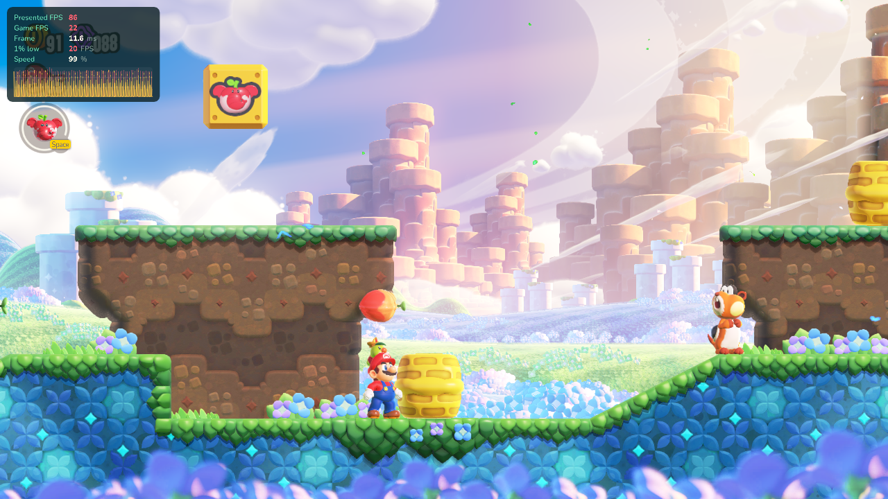
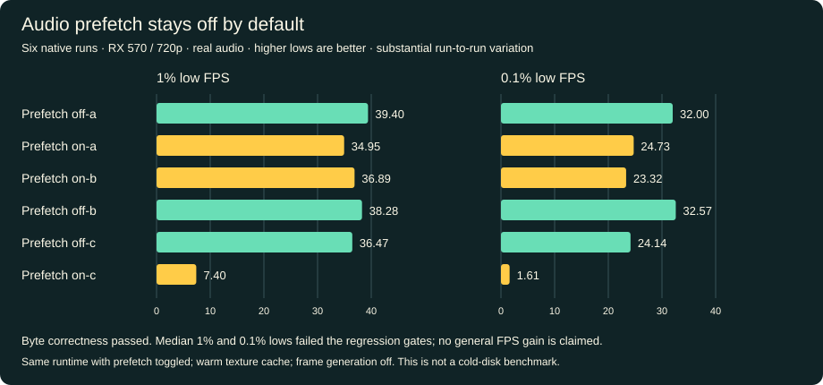

# PC preview r7: verified graphics fixes and a two-PC LAN test build

This follows [r2](PC-PREVIEW-2026-11-17.md), [r3](PC-PREVIEW-2026-11-17-R3.md) and the
[texture conversion cache](TEXTURE-CONVERSION-CACHE.md). Work remains on the fork's draft PR, without an upstream
PR, merge or public binary release. The private runtime-only r7 ZIP identifies source commit
`6b72279b4954763e51e6b9c726fdf7d7db2c819f` and contains no prepared game library, game files, firmware, keys or saves.

## Graphics evidence

[The synchronization investigation](VULKAN-SYNCHRONIZATION-2026-11-17.md) reproduced overlapping texture-write
and clear-to-attachment-load hazards with the real Khronos layer. The corrected route completed title, world map,
Scram, three pause/continue cycles and movement with 4x frame generation and zero validation errors. Unused guest
fragment-output warnings remain documented. This is route-specific evidence, not proof that all flicker is gone.

The screenshot is from the deliberately slower validation run, not a performance benchmark. It uses a normal 16:9
window. The black side borders in the earlier wide-window screenshot demonstrate aspect-preserving presentation;
they are not expanded-camera ultrawide. Fit/Stretch is available; proper Hor+ camera work remains separate.

Readback probes pass 27 counter/clear cases across three GPU modes and 87 generated-picture checks, including
exact stationary pictures, resizing and hard cuts at 2x–8x. Core/synchronization validation reports no errors for
these probes. The standalone warp/ASTC GPU targets passed separately; the latest 27 non-GPU CTest targets also pass.

## Audio: correctness does not imply a performance win

The optional [music/ambience prefetcher](STREAMED-MUSIC-PREFETCH.md) passed 46 exact RAM/file comparisons with a real
XAudio2 device, using six streams and 19.3 MiB of its 64 MiB maximum. Its complete six-run comparison failed the
1%/0.1% low regression gates. It therefore ships **off by default**, explicitly marked experimental. The median
course entry time was effectively unchanged, and there were substantial outliers. No general speedup or removal of
all stutter is claimed. The earlier BGM-only exploratory series is not substituted for this later result.

The timing reporter also stops calling an unexplained stall an upload problem merely because the frame uploaded
several megabytes. It retains `unknown` and shows volume and host CPU time separately; eight reporter regressions pass.

## LAN and UI

[LAN input-wait diagnostics](LAN-DIAGNOSTICS.md) measure the complete synchronization barrier, including the other
PC's scheduling/rendering. They are not a ping or full input-latency measurement. The new compact FPS preset sits
at top right; the detailed preset restores the graph and other metrics. Higher framegen factors use correct FPS
color targets, with game FPS evaluated separately.

The r7 ZIP includes `LAN-TEST-WITH-YOUR-BROTHER.txt`: install the same runtime over each PC's own prepared Wonder
1.0.0 installation, use matching mods, open a room from **Play > Play together > LAN co-op**, connect by LAN IPv4,
port and pairing code, then select **Two Players inside Wonder too**. Both PCs run independently and each player
controls a visible co-op character. Begin with interpolation and experimental audio prefetch off.

Earlier two-instance, two-character tests are documented in r2. A fresh exact-r7 route with independent Mario/Blue
Toad inputs, compact HUD, pause/continue and session exit matched 2,042 valid primary-player samples with zero
position difference. The LAN protocol/barrier is unchanged by r7's telemetry. Physical two-PC verification remains
pending. The guard still checks
only the primary player; there is no full-world checksum, rollback, live reconnect or Nintendo online service.
Preserve both `data/nx.log` files when reporting a failure.
