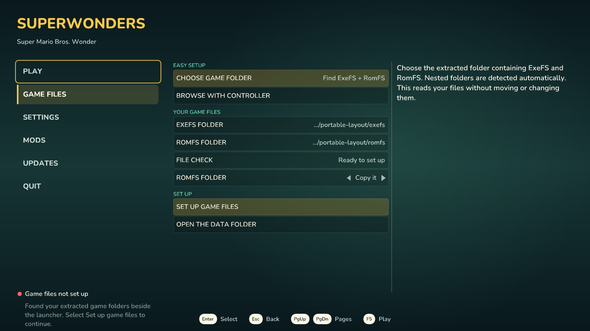

# r8: simpler setup and applied controller mappings

The private r8 runtime and complete setup packages use source commit `105c586f99543ce43afce1ed4b3d39b283a21b34`.
The complete package includes the same verified official v0.4.6 build kit as r7, without game data, a prepared
game library, keys, firmware or saves. Both PCs must upgrade together; r7 and r8 are different runtime fingerprints.
No public binary release, merge or upstream PR has been made.

## Setup

**Game files > Choose game folder** accepts a parent extraction folder once. It finds nested ExeFS/RomFS,
normalizes Windows case aliases, handles sibling picks and loose executable files, and leaves multiple matches
for explicit selection. A limited search does not silently choose an incomplete result. The explicit portable
`exefs/` + `romfs/` layout beside the launcher is filled automatically when no previous paths are saved.

The file check requires actual `main`/`sdk` files and `Shader/*.zs`, then rechecks before building. Missing or
incomplete first-build tools are explained before setup starts. The complete ZIP carries those tools; the smaller
runtime ZIP updates an already prepared installation. The final full ZIP's file manifest is regenerated, and its
optional RecompLauncher descriptor points at this fork rather than the original repository.

The `game_source` tests cover nested/Unicode/case aliases, ambiguous dumps, missing/invalid shader content,
directory-versus-file mistakes, loose executables and bounded searches. The native launcher was also run in
missing-tools, incomplete-tools and portable-layout cases, with successful exits and inspected captures. The
portable case uses synthetic file-layout fixtures, not a real build. The user's own extraction/version remains
subject to the original setup tool's validation. Starting the game in an emulator first is not required.

## Controller and diagnostics

The [Windows Circle-confirm correction](CONTROLLER-PRESET-BRIDGE.md) reaches the actual asynchronous input backend,
instead of the menu displaying a preset that the backend silently clamps. The native probe checks all four face
buttons for each of the three presets and restores temporary settings.

Optional [frame-trace call timing](PERF-SUITE.md#optional-call-timing-in-frame-traces) measures completed logger and
input-poll calls, including total and maximum durations. The reporter preserves older traces and aggregates
original-picture intervals correctly. These columns help investigate remaining stalls; they do not claim a
stutter fix or controller-to-photon latency. Normal tracing-off paths add no clock reads.

## Validation and remaining work

The Windows runtime builds and 28 non-GPU CTest targets pass; the later Windows case-alias regression also passes.
Three native setup-page checks pass. The exact packaged r8 runtime also passes 27 counter/clear GPU cases, 87
frame-generation readbacks at 2x–8x, four overlay/input bridge checks and eight CPU texture-cache cases. All five
GPU/UI probe processes confirm the Khronos validation layer with zero validation errors; the CPU-only texture
case is exempt from layer loading. Previous graphics,
shader-cache, framegen and [r7 evidence](PC-PREVIEW-2026-11-17-R7.md) remain documented at their tested versions.

The fresh exact-r7 two-instance LAN route matched 2,042 valid primary-player positions with independent Mario and
Blue Toad inputs and zero position difference. This is a partial guard, not a full-world checksum. Real two-PC
testing, all courses/actors, every controller and a new real first build from the brother's extraction remain
unverified. Nintendo online, DLSS/temporal FSR and expanded-camera ultrawide remain unimplemented. Audio prefetch
stays off by default after its failed pacing gate. There is no zero-input-delay or all-defects-fixed claim.
