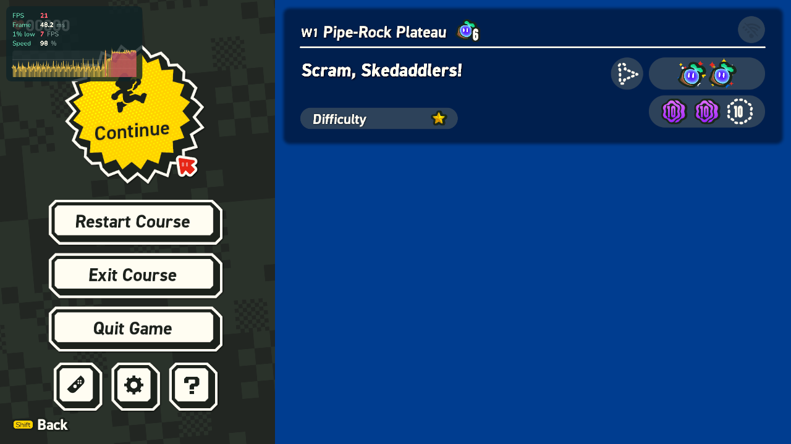
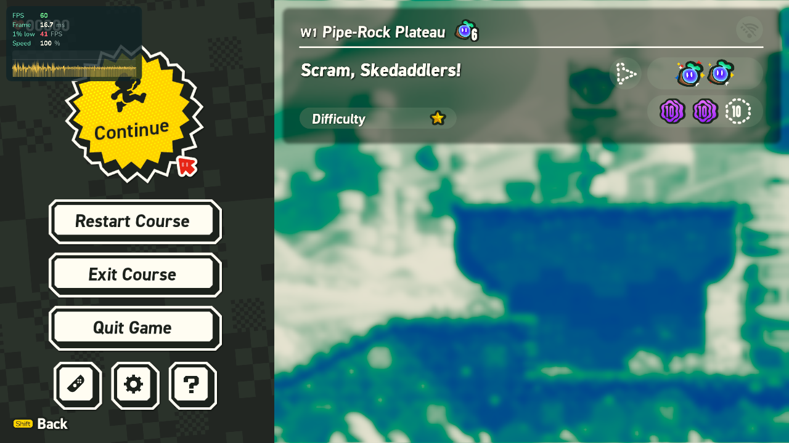
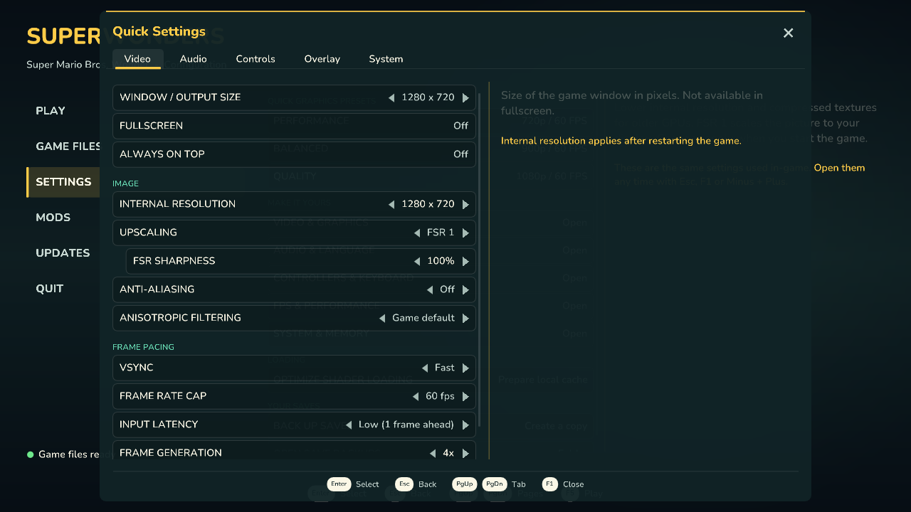
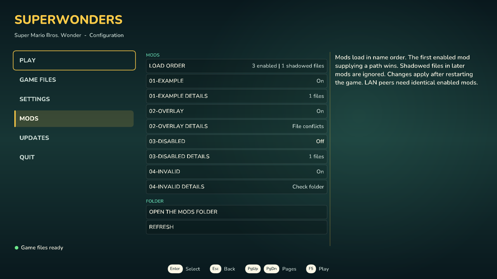
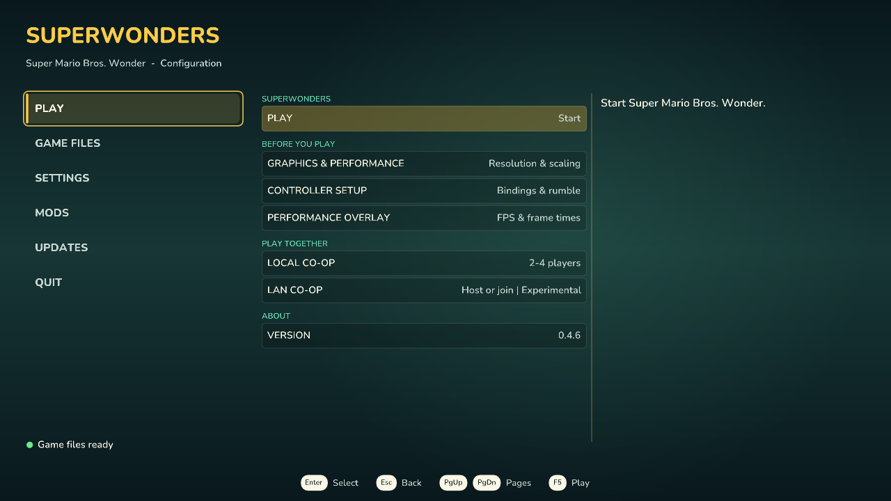
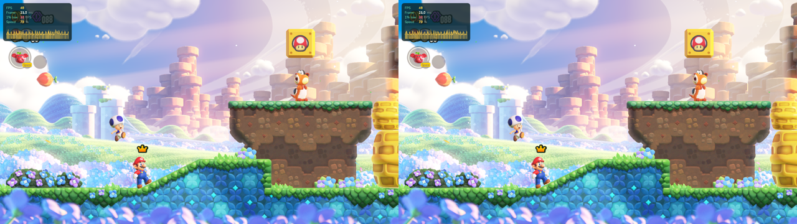

# Windows PC preview: pause captures, presentation and controls

This follow-up fixes the reproduced blue pause background and expands the PC settings on the fork's experimental
preview. It builds on the rendering, shader-cache, controller and native LAN changes documented in
[FORK-ROADMAP.md](FORK-ROADMAP.md). It is not a claim that every course, GPU or crash has been verified.

## Blue pause background

Reproduction: enter **Scram, Skedaddlers!**, press Plus, continue, and pause again. The game should render its own
captured, blurred/tinted scene behind the right side of the menu. The previous runtime showed a solid blue area.





These are native Vulkan swapchain captures from the private test profile, not mockups. The FPS panels in captures
are incidental and must not be used as an A/B performance benchmark; diagnostics and first-use work affect timing.

The problem had three related parts:

1. `SetRenderEnableConditional` discarded the report comparison and always enabled rendering.
2. Clears ignored render-enable state altogether. A repeated clear erased the captured picture before its blur.
3. Counter reports wrote CPU-visible completion during command encoding. With real condition checks, that still
   allowed capture storage to be reused before the GPU finished; repeated pauses could remain intermittently blue.

The replay now retains the two 64-bit report counters and comparison mode, applies the condition to draws and
clears, and leaves timestamp-only report counters at zero. It keeps command-order report values for comparisons
while publishing CPU-visible results after the submit fence. Ordered uniform updates also update pending reports.
Unmapped or unsupported conditions retain conservative drawing rather than blindly dereferencing guest pointers.
GPU aliases of the same report storage share the command-order value. Seven synthetic replay/readback cases cover
these rules in synchronous, asynchronous and pipelined submission modes: 21 passing GPU case results.

The real-game repetition test opened the pause screen three times successfully with frame generation off, and
another three times with 4x enabled. Returning to play and moving/jumping still worked. The green/blue tint is
generated by the game's pause-composite shader and its own colour uniforms; no replacement background was added.
This does not establish pixel-identical output to a hardware capture.

An opt-in `NX_TRACE_REQUEST=1` diagnostic accepts a `trace_capture` file in the data directory containing a frame
count, capped at six. It records replay/clear/condition details for that short interval. It does no file polling in
normal runs and should remain off during performance measurements.

## Frame generation: 2x through 8x

**Settings > Video > Frame generation** now offers Off and 2x, 3x, 4x, 5x, 6x, 7x and 8x. Existing enabled 2x settings
keep their meaning; the new `framegen_multiplier` defaults to 2. Frame generation remains off by default.

The runtime captures consecutive original pictures, estimates optical flow once, and synthesizes distinct
intermediates at `i / multiplier`. It presents them in chronological order, followed by the current original.
One shared flow calculation serves all intermediates. The number of output images is bounded, history resets on
size/factor changes or long gaps, and allocation failure falls back to normal presentation. Reducing the factor
can retry after a higher-factor allocation failure. The descriptor ring and image lifetimes remain bounded.
Pipeline statistics and periodic cache maintenance run once per game picture; generated pictures no longer multiply
the save frequency or divide the reported per-game replay/submission work by the interpolation factor.

The GPU regression covers 17 cases: three small-size/resize cases, moving 720p inputs at every factor 2..8, and
stationary 720p inputs at every factor. It checks **all 59 generated outputs**, including non-midpoint phases.
All outputs passed; stationary inputs remained byte-identical. A native 4x course run also rendered and presented
three distinct generated pictures per game picture, with separate Game FPS and Presented FPS counters. Presented FPS
counts host submissions; mailbox replacement and the monitor's refresh can limit how many are actually seen.

This is picture interpolation, not DLSS or FSR 3. Higher factors consume more GPU time, can introduce artifacts,
and can increase latency. They do not increase simulation speed. For 60 game FPS, 4x targets 240 presentations/sec;
a 60 Hz panel cannot show 240 distinct refreshes. No locked-frame-rate or artifact-free guarantee is implied.

## Input and latency



- **Esc opens PC settings in-game.** Esc closes the menu, cancels binding capture, or backs out of a popup as
  appropriate. F1 and the controller's Minus+Plus chord still work. Esc is reserved for PC settings and is not also
  delivered as the game's Minus button while the modern overlay is enabled. Rebind the game action if needed.
  The old default Esc-to-Minus binding migrates to Backspace, including its in-game keyboard prompt.
- **Input latency > Low** limits render-ahead to one queued picture instead of the previous two. Balanced allows
  two for more CPU/GPU overlap. Switching modes drains outstanding old presentation slots before reusing them.
  This bounds queueing; it is not proof of a particular millisecond reduction or zero input lag.
- **PlayStation: Circle confirms** swaps Cross/Circle only, leaving Square/Triangle intact. The existing bottom-button
  confirmation and Nintendo layout remain available. Per-action custom bindings take priority. Restart after
  changing bindings/prompts so the game's cached font atlas is rebuilt.
- The native overlay probe exercises Esc opening/closing, F1, the controller chord and input isolation on a real
  Vulkan swapchain, without game files. Settings tests cover migration, multiplier persistence, the new preset,
  and queue-limit persistence.

## Stutter diagnostics

The existing timing reporter was not called from the NVN host-present path. It is now connected, with swapchain
acquisition, host presentation, replay and upload measurements. Its CSV also associates the first HID sample of a
game frame with that picture's host presentation. LAN samples are marked before the input-exchange barrier.

`sample_to_present_ms` is a **diagnostic proxy**. It excludes controller polling, USB/Bluetooth transport, display
scanout and pixel response, and is not a full button-to-photon measurement. The `original_picture` column separates
generated pictures from source pictures. A synthetic-clock regression verifies frame association, repeat reads,
ring wraparound, row formatting and generated-picture labels.

On Windows, run:

```powershell
powershell -ExecutionPolicy Bypass -File .\tools\trace_performance.ps1 -GameRoot 'C:\Games\SuperWonders'
```

Use the actual prepared installation path. Play through the stutter, then quit normally. The report stays in
`data/performance-<timestamp>.csv`. The collector includes the two newest reports up to 32 MiB each. It copies
neither game assets, save files nor shader binaries. See [PERF-SUITE.md](PERF-SUITE.md) for column definitions.

The observed sessions contain slow asset reads and occasional long frames as well as shader preparation.
Attributing every hitch to shaders is not supported. Preserving draws can still cause a first-use compilation wait;
the alternative draw-skipping setting can visibly omit objects. No working caches are deleted as a general fix.

The follow-up also corrects a concrete file-position race. `GetFileSize` previously sought to the end and back while
streaming reads ran outside the filesystem table lock. Seek/write/flush was similarly not protected as one operation
against reads of the same `FILE`. Size queries now use descriptor metadata without changing position, and positional
reads/writes use a common helper with per-file locking where required. Actual opens and virtual-file creation run
outside the global handle-table lock. Short writes and flush failures return an error instead of success.
The concurrent regression uses temporary storage and checks disjoint data, offsets, file length and invalid ranges.
This fixes the race; it does not establish that it caused a particular visual report or the open Badge-House issue.

## Mod management



The launcher now reports enabled mods, detected RomFS layouts, file counts and sizes, malformed folders and
conflicts. A later enabled mod lists files already supplied by an earlier mod; the first enabled mod wins.
Disabled mods never claim files in the conflict report. Inspection is bounded and avoids descending into links.
Linked folders and incomplete scans are identified explicitly.

Changes are applied on restart. Toggle failures are reported, and a rename cannot overwrite an existing opposite
enabled/disabled folder. Mod selection is locked while preparing or connected to a LAN room, because its fingerprint
has already been negotiated. This manager handles RomFS replacements, not arbitrary executable patch installation
or an online mod marketplace. The filesystem regression covers nested layouts, case-insensitive conflicts,
disabled mods, invalid layouts and conflict resolution after a rescan.

## LAN verification and remaining limits

Two independent Windows processes run their own game simulation and renderer; neither streams video to the other.
The native launcher exposes LAN co-op under Play together:



The new presentation/counter changes were exercised through the launcher's host/join path. The extended run checked
more than 14,000 matching valid primary-player samples, independent input scripts, pause/resume and an eight-second
period with the client restricted to two logical CPUs; the client's original CPU affinity was restored.
That initial run selected one player in the game menu, so it establishes transport/simulation behaviour rather than
independent control of two co-op characters.

The repetition script was subsequently corrected to explicitly select **Two players**, rather than relying on a
remembered menu selection. The Mario/Blue Toad run recorded **20,939 matching valid primary-player samples**, including
independent guest movement/jumping, pause/resume, Restart Course and a return to the world map. The guest's jump
is visible in both native games while the host's Mario stands still. A separate physical-PC test remains outstanding. Match the player count in the game,
then let each peer choose a character. Use identical runtime binaries, prepared game data and enabled mods.
A final two-character run after the file-I/O correction recorded another **10,227 matching valid samples with zero
mismatches**, including independent guest movement and jumping.



The state guard covers selected primary-player course/position data, not every actor, RNG stream or physics object.
LAN remains experimental, follows the slowest peer, and has no rollback or live reconnection. Nintendo online
services, DLSS and temporal FSR are not implemented. Broader course coverage, four physical PCs/controllers,
cross-platform builds and a full crash/flicker audit remain unverified.

## Automated verification

The configured Windows suite passes **23/23**, including the new concurrent file-I/O, frame-trace association and
mod-catalogue regressions, the controller/prompt/settings tests, native TCP/session/save/lobby tests and the existing
warp/ASTC GPU checks. The additional runtime probes check all 59 generated pictures, 21 counter/clear GPU cases and
native overlay input isolation. Native game captures and two-instance sessions supplement those synthetic checks;
none of these establish that untested courses, drivers or physical networks are defect-free.

## Source references and delivery

- Upstream `vfjoo888/SuperWonders` was fetched again on 2026-11-17; its main still matched base
  `c9fff40c9fc8aad348b5c001d6d1490bc2311e2e`, with no new commits to merge.
- [MKW frame-generation releases](https://github.com/adriadam10/mkw-recomp/releases) and
  [its implementation](https://github.com/adriadam10/mkw-recomp/blob/main/runtime/gfx/vk/device/vk_framegen.c)
  informed presentation scheduling; [its latency diagnostics](https://github.com/adriadam10/mkw-recomp/blob/main/runtime/gfx/vk/device/vk_latency.c)
  informed the measurement boundary. Existing MIT notices remain included.
- [NVN conditional-rendering implementation notes](https://git.dukantic.fr/dukantic/nxnative_patch/src/branch/oot-merge/dm/gfx/nvn/nvn_mtl.m)
  helped identify the timestamp-counter/clear interaction. The correction was implemented and tested in this backend.
- Work remains in the fork's [draft PR](https://github.com/VictorMerk/SuperWonders/pull/1). No upstream PR, merge or
  public binary release was created. The runtime ZIP contains no prepared game library, game assets or saves.
