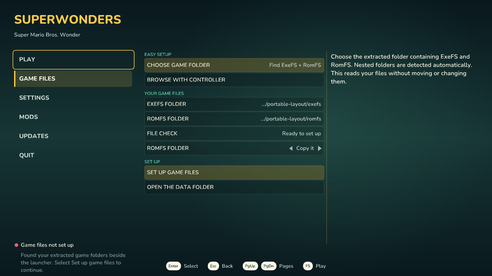
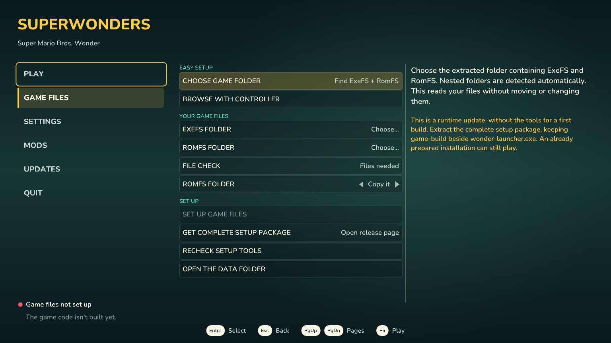

# Choose one extracted game folder

Game files now has **Choose game folder**: select the parent of your own extracted Wonder 1.0.0 files once,
then select **Set up game files**. The launcher locates ExeFS and RomFS without requiring two exact folder picks.
It does not extract encrypted containers or accept an emulator's shader cache in place of game content.

```text
My Wonder extraction/
  ExeFS/
    main
    sdk
  RomFS/
    Shader/
      ... .zs
    Layout/
    ...
```

The native system folder picker and the controller folder list both feed the same discovery. Nested extraction
folders are supported, as is selecting ExeFS or RomFS itself when its counterpart is a sibling. Loose main/sdk
files beside a RomFS subfolder are also supported. If both paths are unset and the launcher has valid `exefs/`
and `romfs/` folders beside its EXE, those exact paths are filled automatically. Existing saved paths are kept.

The file check requires regular `main`/`sdk` files and actual `.zs` files directly in `Shader`, instead of treating
the presence of an empty Shader directory as success. Setup rechecks those conditions before starting Python.
These checks establish the folder layout; the original build tools still validate the game executable/version.
Playing the game first is not required to create the `.zs` files.

Discovery runs on a worker, reads without moving or modifying game data, and is limited to four subfolder levels,
512 directories, 10,000 entries and a two-second elapsed-time budget between filesystem operations. Slow OS I/O
can exceed that budget. The compiler kit and identified RomFS asset trees are not walked. Symlink children are
skipped. Multiple matches remain explicit choices; a limited search does not automatically select the only match
found so far. Choose a closer parent folder if the search limit is reached. The individual ExeFS/RomFS rows remain
available for separate extractions, and selections are saved after discovery.

Missing first-build tools are now reported on Game files before a build starts. The setup action stays disabled;
the page offers the compatible complete package and **Recheck setup tools**. Prepared installations can still play.
Keep the complete `game-build` folder, its Python and both EXEs together when extracting the setup ZIP.

## Validation

The `game_source` CTest target exercises Unicode/nested paths, direct and sibling selections, multiple dumps,
empty/wrong Shader content, missing paths, directories pretending to be executable files, loose executable layout,
compiler-kit exclusion and the depth bound. These use disposable synthetic files, not game content or a real build.
The Windows runtime builds successfully. Three native launcher tours also pass: absent tools, incomplete tools
and the explicit portable folder layout. Captures show the appropriate warnings/disabled build action or the
automatically populated paths/enabled action. These use synthetic layout fixtures and never execute a setup build;
they do not establish that an arbitrary user's extraction is complete or the correct game version.




