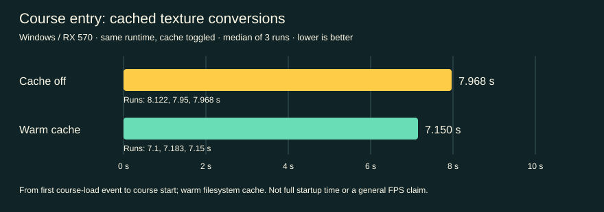
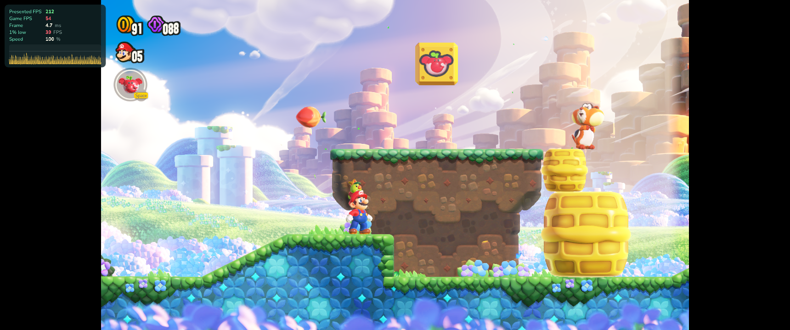

# Low-VRAM texture conversion cache

The low-VRAM profile decodes unsupported ASTC textures on the CPU and encodes BC3 before upload. Clean native traces
showed long initial replay work with hundreds of milliseconds of ASTC decoding, while very few new pipelines were
built. This cache targets that conversion work; it is not a shader-cache replacement or a fix for every hitch.

**System > Cache texture conversions** enables reuse on later loads. It is on by default and applies to future
conversions immediately. `NX_TEXTURE_CACHE=0` disables it for controlled comparisons. Only the low-VRAM ASTC-to-BC3
path uses it; native ASTC and the normal GPU-to-RGBA decode path retain their existing behaviour and quality.

## Correctness and bounds

- Cache files live under the player's private `data/texture-cache-v1`. They contain game-derived texture data and
  must not be included in a shared runtime package, PR or diagnostic upload.
- Two fingerprints select a filename, but fingerprints alone never establish a hit. The complete original linear
  ASTC bytes and explicit format/layer/mip-layout metadata must match. BC3 output has a checked checksum and a
  derived, bounded layout. Changed mods/textures miss naturally; damaged/truncated entries fall back to conversion.
- File sizes, source/output sizes, dimensions, layers, metadata and mip counts are bounded before allocation/use.
  A result is never published from an incomplete write. Atomic staging preserves a previous complete entry on failure.
- Completed entries use a 256 MiB / 4,096-file budget, evicting oldest completed entries on the background writer.
  Only strictly named regular cache files are eligible; unrelated files and links are left alone. Filesystem errors
  are best effort and do not prevent the original conversion path.
- New writes are bounded to 64 queued jobs and 16 MiB of pending source/result payloads per process. A full queue
  drops a cache write rather than blocking presentation or growing memory without bound. Shutdown drains the writer.
  Interrupted-process staging directories may remain, as with the existing atomic cache writer.
- A failed write stops further cache writes for that session, with one diagnostic message; existing entries can
  still be read. This avoids repeatedly copying/enqueuing data for an unwritable/full disk. Restart after fixing it.
- The initial directory index avoids a separate failed file open for every new texture on a slow drive. The index
  lock is not held during file reads/writes. Cache state is local to the prepared installation.

## Verification

The standalone cache test covers Unicode paths, process-style reloads, exact source comparison including a forced
fingerprint collision, incompatible metadata, corrupt output, truncated records, byte/file quotas, unrelated-file
preservation, invalid paths and filesystem failure. The configured Windows suite passes **27/27** at this stage.

`NX_TEXTURE_CONVERSION_PROBE=1` uses original synthetic ASTC blocks with irregular dimensions, three mip levels,
one/two layers and linear/sRGB decode. Its eight cold/warm cases compare the complete BC3 bytes and mip layouts
against the existing uncached converter; all pass. No game data is needed for that probe.

For a private real-game verification run, `NX_TEXTURE_CACHE_VALIDATE=1` freshly converts each cache hit again and
compares all output bytes/layouts. A mismatch logs FAIL and uses the fresh conversion. This deliberately expensive
diagnostic must stay off in performance measurements. Normal runs use source verification and the output checksum.

The private native verification route checked **230 real-game cache hits** by fresh conversion, with zero output
byte/layout mismatches. Three uncached and three warm-cache runs used the same runtime, private profile, 720p/60
target and scripted pause/movement route. An extra uncached/warm pair after the first warm runs checked the order
effect. Performance runs had screenshots and fresh-conversion validation disabled.

The median time from the first course-load event to course start was **7.968 s uncached / 7.150 s warm-cache** on
Windows/RX 570. The median longest host frame in that loading window was **1036.71 / 298.18 ms**; recorded CPU ASTC
decode time there changed from **433.8 / 0.0 ms**. Other file reads and hitches remain. Play-window medians meet the
existing 1%/0.1% low, over-50-ms and stutter regression thresholds; the results do not establish a general FPS gain.
These are warm-filesystem results for one route, not cold-disk/reboot or whole-game startup measurements.

The fitted 1720x720 native game was also visually checked with 4x interpolation, three pause/resume cycles and
movement/jumping. The selected low-VRAM texture quality is unchanged:

